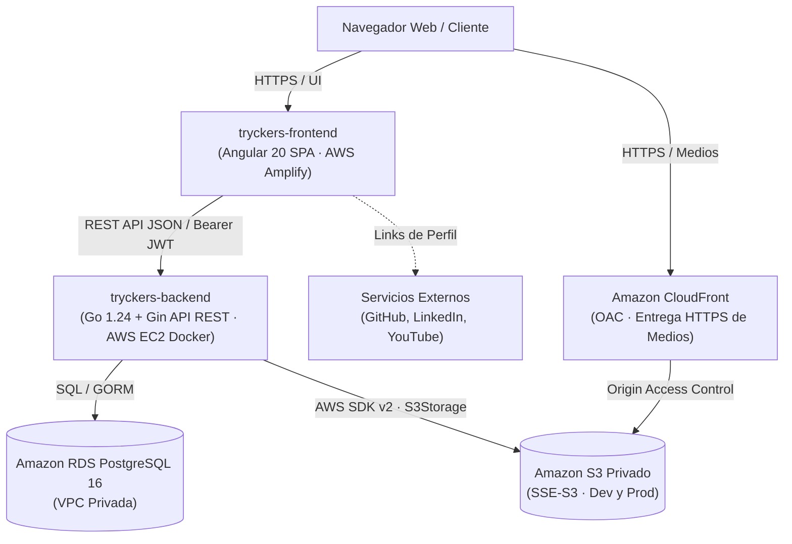

> Idioma del proyecto: **español**. Escribe este conocimiento en español. Mantén en inglés el código, los nombres de archivo, los comandos y las claves de configuración.

# tryckers — System Context

## System Purpose

Tryckers es una plataforma y red profesional técnica diseñada para la comunidad de desarrolladores de software en Latinoamérica. El sistema permite construir identidad profesional respaldada por código y proyectos reales, publicar y debatir artículos técnicos, votar contenido de la comunidad y conectar con oportunidades laborales y reclutadores.

## System Components

### Component Breakdown
1. **`tryckers-frontend` (SPA — AWS Amplify):** Interfaz de usuario reactiva (`https://tryckers.trycatch.tv`) para autenticación con renovación automática de JWT, gestión de perfil, directorio de miembros, editor de publicaciones, cartelera semanal (Light/Dark Mode) y comentarios. Muestra versión y commit desplegado en el footer (`vX.Y.Z · build <sha>`).
2. **`tryckers-backend` (Core API — AWS EC2 Docker):** Servidor HTTP en Go (`https://api.tryckers.trycatch.tv`) que expone endpoints REST versionados (`/api/v1`), maneja lógica de dominio, validación de DTOs, autenticación JWT (`5h` access / `7d` refresh) y carga/resolución de medios vía `StorageService`.
3. **`postgres-db` (Amazon RDS PostgreSQL 16):** Motor relacional en VPC privada para usuarios (con índice único case-insensitive en `username`), credenciales hasheadas, perfiles, publicaciones, votos, comentarios y `object_key` de archivos multimedia.
4. **`s3-media-storage` (Amazon S3 Privado):** Buckets privados con cifrado SSE-S3 (`tryckers-media-storage` en Prod, `tryckers-media-storage-dev` en Dev) para avatares, banners e imágenes de publicaciones (`LocalStorage` solo como fallback offline/pruebas).
5. **`cloudfront-media-cdn` (Amazon CloudFront + OAC):** Entrega HTTPS pública de archivos multimedia directamente desde el bucket S3 privado en producción.

## Integration Model

- **Protocolo de Comunicación:** HTTP/REST sobre HTTPS con payloads JSON.
- **Autenticación en Tránsito:** Cabecera estándar `Authorization: Bearer <JWT>` + rotación de refresh token en `POST /api/v1/refresh-token` con coordinación de `401` concurrentes y sincronización multi-pestaña en frontend.
- **Subida y Entrega de Archivos:** Requests `multipart/form-data` hacia el backend (`S3Storage`), persistencia de `object_key` en PostgreSQL y entrega de URLs resueltas por entorno (CloudFront en Prod, `/media/*` en local).
- **Cross-Origin Resource Sharing (CORS):** Control centralizado en middleware de Gin para validar el origen del cliente web (`FRONTEND_URL`).

## Deployment Topology

- **Entorno de Desarrollo:**
  - Backend: Go local en `:8080` conectado a PostgreSQL local y bucket S3 Dev (`tryckers-media-storage-dev`) vía perfil AWS CLI.
  - Frontend: Angular local (`ng serve`) en `:4200` con `buildCommit: 'local'`.
- **Topología de Producción (AWS `us-west-2`):**
  - Frontend: AWS Amplify (`d38qa3mp68ehik`, rama `main` → `https://tryckers.trycatch.tv`).
  - Backend: Docker multi-stage (`alpine:3.21`) en AWS EC2 (`i-007cfaf0508858c13`), desplegado automáticamente vía GitHub Actions (`Backend CD`) → Amazon ECR → AWS Systems Manager (SSM).
  - Base de datos: Amazon RDS PostgreSQL 16 en VPC privada (acceso administrativo vía SSM + `postgres:16-alpine`).
  - Almacenamiento multimedia y CDN: Amazon S3 privado (`tryckers-media-storage`) + Amazon CloudFront OAC.

## Cross-Cutting Concerns

- **Autenticación y Autorización:** JWT HS256 con `exp` obligatorio y validación estricta de `type` (`access` vs `refresh`), refresh tokens con rotación, y control de acceso basado en roles (`Admin`, `Member`, `Recruiter`).
- **Seguridad de Datos:** Contraseñas hasheadas con bcrypt, secretos gestionados en AWS SSM Parameter Store, bucket S3 privado sin acceso público directo y no exposición de campos sensibles (`json:"-"`).
- **Manejo de Errores:** Respuestas de error estandarizadas con códigos HTTP semánticos y mensajes descriptivos en español; diferenciación entre errores definitivos de sesión y errores transitorios de red/servidor.
- **Documentación de API:** Especificación OpenAPI / Swagger accesible en `/swagger/index.html`.
